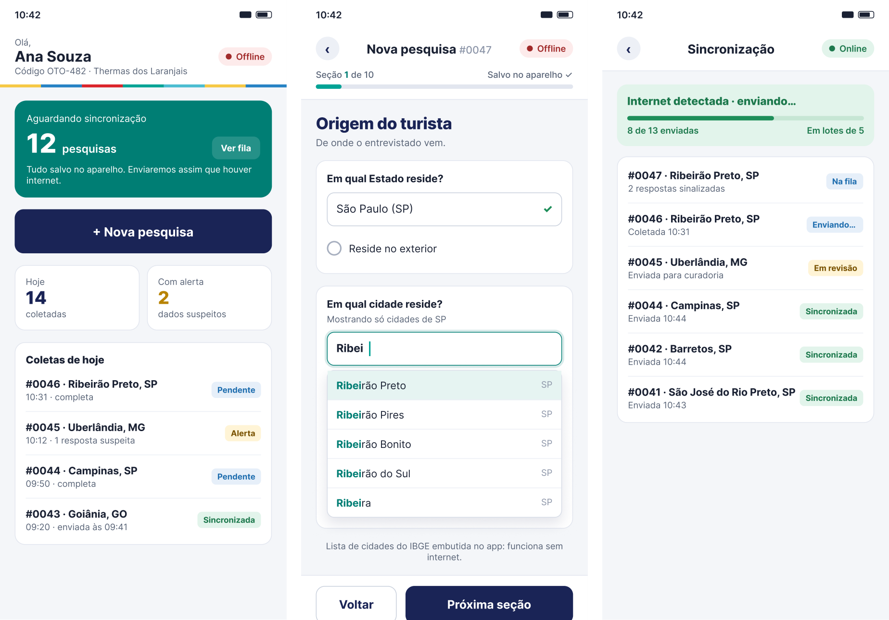
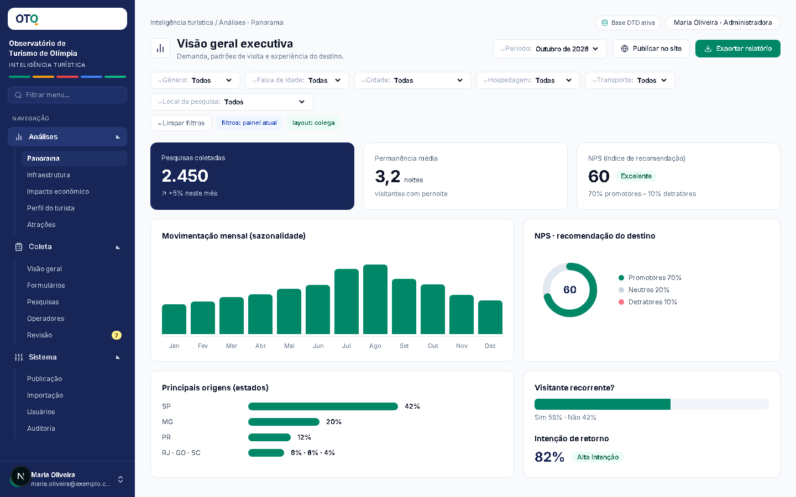
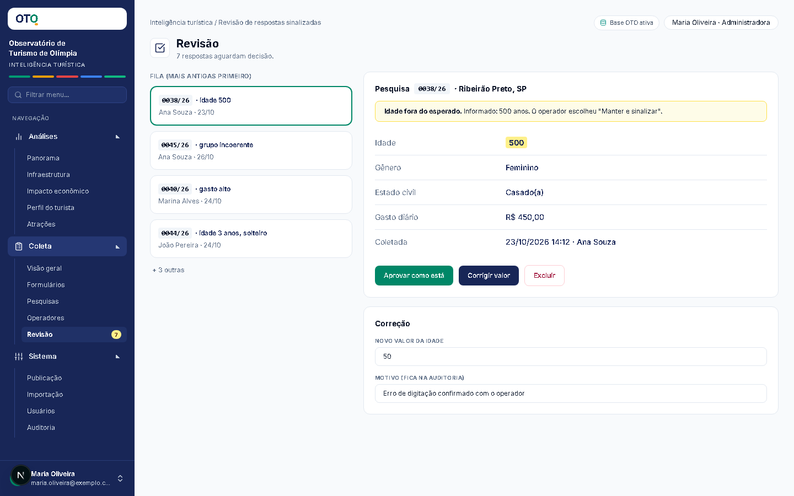

# OTO — Observatório de Turismo de Olímpia

[](https://github.com/gabriel-huemer/olimpia-research/actions/workflows/ci.yml)

[](https://sonarcloud.io/summary/new_code?id=gabriel-huemer_olimpia-research)

Sistema para a Secretaria de Turismo de Olímpia (SP) coletar e analisar pesquisas com turistas. O pesquisador aplica o
questionário pelo app, mesmo sem internet, e os gestores acompanham os resultados no painel web.

Projeto do Grupo 7 da disciplina SSC0536 – Projeto e Desenvolvimento de Sistemas de Informação (ICMC-USP, 2026).

## Telas

App do pesquisador (protótipo no Figma):



Painel web:





## Estrutura

| Pasta | O que é | Tecnologia |
|---|---|---|
| `android-app-olimpia/` | App do pesquisador de campo | Flutter |
| `dashboard/` | Painel web dos gestores | Next.js |
| `oto-db/` | Banco de dados central | PostgreSQL 16 |

Como rodar cada parte: [oto-db/README.md](oto-db/README.md) e [dashboard/README.md](dashboard/README.md).

## Bancos de dados: real e demonstração

| | `oto` (real) | `oto_demo` (demonstração) |
|---|---|---|
| **Dados** | Pesquisas de verdade, feitas pelo app | 700 pesquisas **fictícias** (jan a nov/2026), geradas por script |
| **Quando usar** | Desenvolvimento do dia a dia, testes com o emulador, coleta de campo, homologação | Gravar vídeo, apresentar o projeto, mostrar gráficos "cheios" |
| **Arquivo de ambiente** | `dashboard/.env.real.local` | `dashboard/.env.demo.local` |
| **Painel inicia vazio?** | Sim (só o que você coletou) | Não: Panorama e lista de Pesquisas já vêm preenchidos |

Os dois bancos ficam no **mesmo container** PostgreSQL, com o mesmo schema e seeds. Quem escolhe o banco é o painel
(`dashboard/.env.local`); o app Android sempre fala com o painel, então grava no banco que o painel estiver usando.

```bash
cp dashboard/.env.demo.local dashboard/.env.local    # modo demonstração
cp dashboard/.env.real.local dashboard/.env.local    # modo desenvolvimento (banco real)
# depois de trocar, reinicie o painel (npm run dev): as conexões ficam em memória
```

Como criar/recriar o banco demo: [oto-db/demo/README.md](oto-db/demo/README.md).

## Como entrar com cada usuário

| Usuário | Onde entra | Login | Senha | O que vê |
|---|---|---|---|---|
| Visitante (Visualizador) | Painel | **não faz login** | não tem | Só Análises |
| Administrador | Painel (entrada da equipe) | `admin.teste@oto.local` | `TEST_ADMIN_SENHA` | Análises, Coleta e Sistema |
| Pesquisador | App | código `OTO482` (Ana), `OTO117` (Bruno) ou `OTO305` (Carla) | não tem | Coleta de pesquisas no app |
| Equipe com perfil personalizado | Painel (entrada da equipe) | e-mail cadastrado em Sistema → Usuários | definida pelo administrador | As áreas marcadas no perfil |

**Entrada da equipe:** abra `/administracao` (ex.: <http://localhost:3000/administracao>). Não há botão nem link para
essa página no painel público. Só entra quem tem Coleta ou Sistema; Visualizador e Pesquisador são recusados
com a mesma mensagem de senha errada. O script abaixo também cria `visualizador.teste@oto.local` e
`pesquisador.teste@oto.local`, usadas só para testar esse bloqueio.

**As senhas não ficam no Git** (o repositório é público): cada pessoa gera as suas. Com o banco no ar
([oto-db/README.md](oto-db/README.md)), os comandos abaixo criam as contas de teste; não use essas contas em produção.

```bash
cd oto-db
# banco já criado antes desta versão? aplique as migrações novas (V005):
docker exec -e PGUSER=oto_admin -e PGDATABASE=oto oto-db bash /oto/scripts/bootstrap.sh
# cria as 3 contas e grava as senhas em um arquivo ignorado pelo Git:
docker exec -e PGUSER=oto_admin -e PGDATABASE=oto oto-db \
  bash /oto/scripts/criar_usuarios_teste.sh > .usuarios-teste.oto.env
chmod 600 .usuarios-teste.oto.env
cat .usuarios-teste.oto.env      # mostra e-mails e senhas
```

- **Cada banco tem suas contas:** para o demo, troque `oto` por `oto_demo` em `PGDATABASE` e no nome do arquivo.
  Rodar o script de novo gera senhas novas.
- **Windows (Git Bash):** coloque `MSYS_NO_PATHCONV=1` antes de cada `docker exec`.
- **Antes de entrar:** preencha `AUTH_SECRET` e `SYNC_API_TOKEN` no `dashboard/.env.local`
  ([dashboard/README.md](dashboard/README.md)), suba o painel (`npm run dev`) e abra <http://localhost:3000/administracao>.
- **App:** rode com `--dart-define=SYNC_API_URL=...` e `--dart-define=SYNC_API_TOKEN=...` (o mesmo token do painel).
  Sem a URL, o app simula o envio; com a URL e sem o token, o painel recusa a sincronização.

## Regras de acesso e segurança

| Regra | Como funciona hoje |
|---|---|
| Visitante | Não faz login e vê só Análises. Em Coleta ou Sistema, volta para o Panorama |
| Quem faz login | O administrador e os perfis criados por ele com Coleta ou Sistema. Visualizador e Pesquisador são recusados |
| Entrada | `/administracao`, sem link público. `/login` e `/acesso-oto` não existem |
| Sessão | Dura 8 horas. Desativar a conta ou mudar as áreas do perfil vale na hora |
| Senhas erradas | 5 erros em 15 minutos (mesmo e-mail e mesma rede) bloqueiam por 15 minutos; 20 erros no mesmo e-mail bloqueiam de qualquer rede |
| Senha | Mínimo de 10 caracteres, com letras e números; senhas muito comuns são recusadas |
| Sincronização do app | Exige `SYNC_API_TOKEN`, hoje o mesmo para todos os aparelhos. Sem ele, as pesquisas ficam na fila do app |
| Configuração obrigatória | `AUTH_SECRET` (sem ele ninguém entra) e `SYNC_API_TOKEN` (sem ele o app não sincroniza) |

**Testes:** os de integração criam dados e mexem na curadoria; rode só em um banco descartável (ex.: `oto_teste`), nunca
no `oto` nem no `oto_demo`.

**Banco demo:** o `oto_demo` começa vazio em cada máquina; antes do vídeo, carregue as 700 pesquisas fictícias
([oto-db/demo/README.md](oto-db/demo/README.md)).

## Melhoria futura: administração só na rede certa (Tailscale)

Hoje `/administracao` não tem link público, mas abre para quem souber o endereço; a proteção é a senha, o bloqueio por
tentativas e as permissões. No futuro, poderia ser adicionada uma camada com [Tailscale](https://tailscale.com) (rede
privada/VPN), para que só as pessoas autorizadas, conectadas à rede certa, consigam ver essa tela:

- **Na rede do OTO:** a tela de login aparece normalmente, e a senha continua sendo exigida.
- **Fora dela:** `/administracao` responde "página não encontrada" (404), como se não existisse.
- O mesmo bloqueio precisa valer para Coleta, Sistema e as APIs de login e administração, não só para a tela.
- Continuam públicas as Análises. A sincronização do app precisa continuar acessível em campo (com token) ou o aparelho
  do pesquisador também precisa entrar na rede.

**Ainda não implementado.**

## Equipe

Hugo Rubira Zanni, Gabriel Huemer, João Pedro Baratella Mattos, Mark Seiji Takakura, Gabriel de Oliveira Merenciano e
Breno Wingeter de Castilho.
